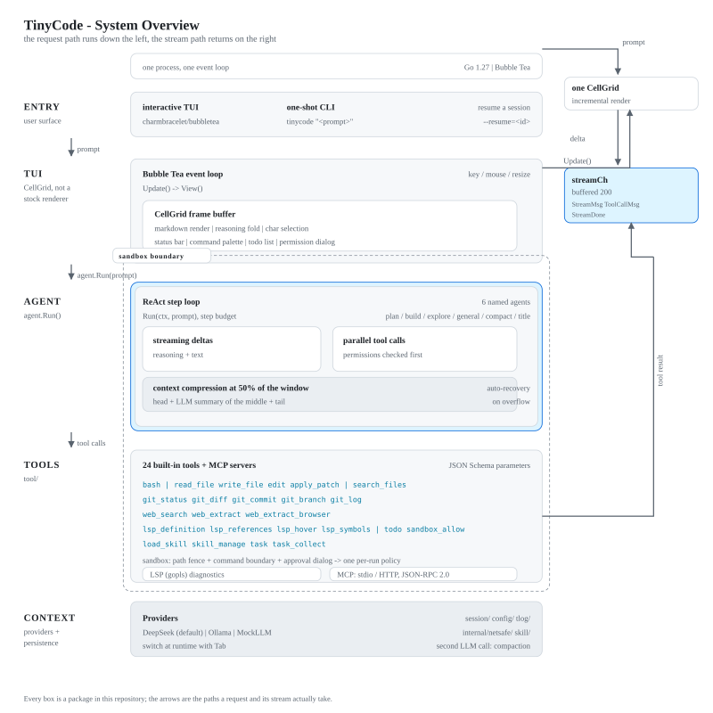
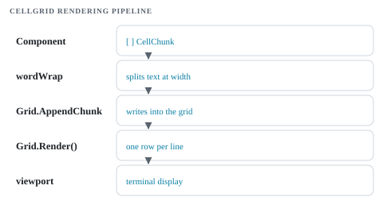
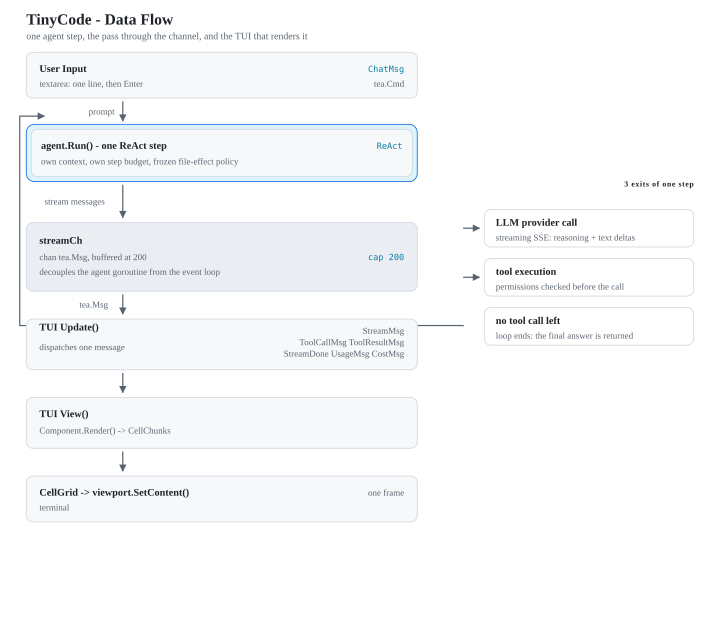

<p align="center">
  
  
  
</p>

<p align="center">
  <b>AI coding agent built from scratch in pure Go &mdash; CellGrid TUI, native MCP client, web scraping, and LSP diagnostics in a single binary.</b>
</p>

<p align="center">
  
  
  
</p>

---

# Features

### Markdown Rendering in TUI
Custom **CellGrid** frame-buffer renders markdown directly in the terminal — no external renderer dependency.

- **Bold**, *italic*, `inline code`, headings, blockquotes, ordered/unordered lists (nested arbitrary depth)
- Fenced code blocks with `\t` → spaces conversion, indentation preservation
- Tables with smart column-width alignment, box-drawing characters (`│ ─ ┤ ├ ┼`)
- Horizontal rules, links, mixed content
- **Incremental streaming**: `parseMarkdown()` on every render tick — no sudden jump from raw markdown to styled output
- 10+ roundtrip tests verify text content survives parse → render → extract

### Session & Persistence
- Auto-save conversations on exit (`~/.tinycode/sessions/TUI-*.json`), with title/preview/metadata
- Resume with `--resume=TUI-20260607-235959`
- List sessions with `--list-sessions` (shows title, message count, last active time)
- **Undo a tool call**: every file-tool write records the bytes it replaced, so `/undo` in the TUI — or `--undo` on the command line — returns the last tool call's files to their previous state. Bounded per project (50 calls / 64 MiB, oldest undone first). A `bash` command's writes are captured too, from a snapshot of the project tree taken before it. See [docs/checkpoints.md](docs/checkpoints.md).
- **A measurement, before a framework**: `TINYCODE_EVAL=1 go run ./eval/runner` runs six small tasks through three agent configurations, grades each attempt by the task's own `go test`, and reports what the trajectories say — solved tasks, noise, tokens per solved task. Gated and never in CI, because it spends money. See [docs/eval.md](docs/eval.md).
- **Every run leaves a trajectory**: one JSONL file per run — steps, per-call durations and TTFT, tokens, cost, and each tool call with a digest of its arguments, its result size and how it ended — written to `~/.tinycode/trajectories` by default, read back with `--trajectories` and `--trajectory <id>`. Metadata only unless you ask for text, bounded at 200 runs / 64 MiB, and not writable by a tool. See [docs/trajectories.md](docs/trajectories.md).
- **A goal that continues itself**: `/goal <objective>` stores one objective in the session — phase, round budget, blocker — and when the session goes idle the agent starts another round toward it, up to 256 rounds, with the objective, the round number and the evidence rule in the prompt. A round may complete or block the goal but never rewrite it; Ctrl+C pauses instead of retrying; a resumed or forked session comes back disarmed until you say `/goal resume` (or just "continue"). The build agent is told to create one for work that will not fit a single turn; `/goal` is the explicit path. See [docs/goals.md](docs/goals.md).
- **Memory that outlives the session**: recall is on by default and reads a local store — one file per project under `~/.tinycode/memory`, deliberately outside the project root and refused to the tool layer, because a fact the agent can rewrite is not one. Nothing is stored unless you ask: `/remember <label>: <fact>` is the only writer, `/memory` lists what is there with the id, and `/memory forget <id>` deletes it. A network backend (Hindsight) is reachable only when your own config file names the endpoint; a project-local config cannot turn it on. Recall matches keywords until you point `memory.embedding` at an embedding endpoint (Ollama, or any OpenAI-compatible `/embeddings`), which switches it to vector similarity with a lexical floor and a weighted rerank; the endpoint is yours to name, and the vectors live beside the facts, keyed by model. The recall benchmark and its lexical baseline live in [docs/memory-bench.md](docs/memory-bench.md). See [docs/memory-decision.md](docs/memory-decision.md).
- **AI-generated session titles**: title hidden agent auto-names conversations via LLM. Falls back to first user message. (2deee5e)
- Input history: Up/Down arrows to recall previous inputs, Esc to exit browse mode
- Status bar shows `hist 3/5` during history browsing

### TUI Features
- **Incremental CellGrid Rendering** — msgDirty/msgRowCount tracking. View() skips unchanged messages, only re-renders from first dirty onward. CellGrid no longer Reset() every frame. Benchmark: ~2.3ms regardless of message count (10/50/100 tested). (ffbbf22)
- **Reasoning folding**: click `[+]`/`[-]` markers to expand/collapse LLM reasoning blocks. Multi-step agent loop now creates **one assistant message per step**, each with its own `[-]` reasoning + `→ Calling tools:` list. (c5f854f)
- **Tool call display**: `→ Calling tools:` with bullet list during tool execution. Duplicate tool calls in the same step no longer appear twice (agent.go fired OnToolCall twice per tool — fixed in cc5a224)
- **Character-level selection**: drag-select any range of viewport text, Ctrl+C copies rendered text (not raw markdown). Range check prevents single-click selects from triggering copy. (ea6711c)
- **[Copy] buttons**: click to copy assistant response to clipboard. Fixed: button row now counted in msgRowCount so subsequent messages don't overlap. (f9143cc). Fixed: button stops working after incremental render — activeButtons preserved per MsgIdx across renders. (8dffd64)
- **Spinner**: `⣾ ⣽ ⣻ ⢿ ⡿ ⣟` braille spinner in status bar during streaming. Tick pipeline kept alive even during idle. Spinner continues across intermediate steps. (42b8794, 9a0f55b, afc14e1)
- **Auto-scroll**: viewport follows streaming output, pauses when user scrolls up
- **Status bar**: mode icon, model name, provider, token count (as a fraction of `budget.max_tokens_per_session` when one is configured), the goal's round (`goal n/256`, with `blocked` or `done` when it stops), what the session is known to have cost per unit plus the count of calls nobody could price, tool/msg counts, session duration, and a transient status message — including `retrying (2/3): …` while a provider call is being re-sent
- **A long task announces itself when it finishes** — a background task, or a run that outlived `notify.min_duration_seconds` (default 30). Terminal escapes by default (`OSC 9`/`OSC 777`), the platform notifier (`osascript`/`notify-send`) when `notify.channel` asks for it, and nothing makes a sound
- **Frame verification** — the rendered frame is a test artifact, not only an assertion target: 32 plain-text golden frames plus one raw ANSI frame under `tui/testdata/golden/` (regenerate with `go test ./tui -run Golden -update`), and `make test-tui-visual` (`TUI_SHOT=1`), which renders the scenarios to PNGs, starts the built binary on a real 80x24 PTY (and once on a size-less one) and replays that live stream into a screen buffer that is rendered too. The mechanism is the nested **[tuiprobe](tuiprobe/README.md)** module (pinned in `go.mod`, released as `tuiprobe/v0.1.0`); the fixtures and the judgments stay here. Reference: **[docs/tui-verification.md](docs/tui-verification.md)**.

### Agent Loop
- ReAct loop with tool calling support (25 tools: bash, read_file, write_file, search_files, edit, apply_patch, git_*, web, LSP, task, task_collect, todo, goal, sandbox_allow, load_skill, skill_manage)
- **Transient failures are retried** — a 429, a 5xx or a connection that dies before any answer is re-sent with exponential backoff and jitter, floored at `Retry-After`; a stream that already delivered text is never replayed, because drawing an answer twice is worse than the failure
- **A tool call is checked before it runs** — arguments are validated against the schema the model was shown (`type`, `properties`, `required`, `enum`, `items`), a call that breaks it is answered with every problem at once instead of being executed, and the same call failing repeatedly is refused as a loop
- **Cumulative token budgets** — `budget.max_tokens_per_run` and `budget.max_tokens_per_session` (0 = unlimited) stop a run before its next provider call once either is reached
- **6 agents**: plan (read-only whitelist), build (full access), explore (read_file + search_files only), general (full execution sub-agent), compact (history compression), title (session naming)
- **Permissions engine**: `Ruleset` with last-match-wins `{action, resource, effect}` rules replacing DeniedTools/AllowedTools. Supports whitelist (`*: deny` + specific allows) and blacklist (`*: allow` + specific denies).
- **Task tool**: Delegate to sub-agents via `task({agent, goal})`. Sync mode (block until done) or bg mode (returns task_id, collect with `task_collect`). Sub-agent steps don't count against parent's step budget.
- **OnStepDone callback**: after each step's tools complete, the agent fires `OnStepDone` — the TUI creates a new assistant message for the next step. Each step gets its own reasoning + tool calls display.
- Agent integration test framework: 13 tests using MockLLM step-by-step
- Streaming reasoning + text deltas
- Tool call lifecycle displayed in real-time
- Multi-turn history compression: Hermes-style head/tail/middle summarization
- 1M token context (`deepseek-flash`, model version DeepSeek-V4.1-Flash) with automatic threshold lowering on `context_length_exceeded` errors

### LSP Integration
- **Config**: `"lsp": { "enabled": true }` in config.json (default: disabled). 7 supported languages with auto-detection: Go (`gopls`), Python (`pyright`), TypeScript/JS (`typescript-language-server`), Rust (`rust-analyzer`), C++ (`clangd`), Java (Eclipse JDT).
- **4 tools** exposed to LLM: `lsp_definition` (→ `Definition at path:line:col`), `lsp_references` (→ `Found N references`), `lsp_hover` (→ type info + docs), `lsp_symbols` (→ all symbols in file). All require `file_path`, `line`, `character` (0-indexed).
- **Architecture**: `lsp.Init(<project root>)` records the workspace (the language server is rooted at the project, not at the session directory) and the server starts lazily on the first `SyncFile`. One reader goroutine owns the stream and dispatches responses to per-id channels plus `publishDiagnostics` to a diagnostics channel; the connection is reused by every later tool call and shut down on `Close()`. If no persistent client is available, a tool falls back to a one-shot `exec.Command` server for that call.
- **Incremental Diagnostics** — `SnapshotBaseline(path, content)` captures diagnostic state from the pre-edit bytes before edit/write_file/apply_patch, `GetNewDiagnostics(path, content)` computes the delta from the bytes just written. Tools report only new errors via LSP — LLM sees focused feedback. (a2e3e07)
- **TUI Error Tracking** — an in-memory registry (severity-1 diagnostics per file) is refreshed off the event loop after each tool result and on the spinner tick, so the status bar `errors: N` and `/diagnostics` reflect the live state. (290818a)
- **Mock test framework** — `io.Pipe` based, no LSP server required; covers all 4 tool types, concurrent request correlation and reader-death handling. (8065ae5)
- **Integration tests** — `make test-lsp` runs the suite against a real `gopls` (the Nix devShell provides it, `make install-gopls` installs the pinned version elsewhere); CI runs them in a dedicated job. They cover a valid file reporting no errors, a broken file reporting its undefined symbol, and the error clearing after a fix.
- **Limitation**: the first call of a session pays the server startup cost (~500 ms); subsequent calls reuse the connection. The one-shot fallback (no persistent client) still pays it per call.

### Todo System
- **TodoStore**: Task list with CRUD (create/read/update/merge/delete/summary). Enforces one `in_progress`, max 256 items, max 4000 chars per task. The list is **session state**: it is stored in the session file and restored by `--resume`, `/session` and `/fork`, so one session's plan cannot leak into another.
- **todo tool**: OpenAI function-calling schema, registered in all modes. LLM calls it to plan and track multi-step work.
- **Compression protection**: After context compression, active todo items (pending + in_progress) are re-injected so the LLM doesn't redo completed work.
- **Housekeeping mute**: When all tool calls are `todo`, the model's text reply is suppressed — no noise, just progress markers.
- **Session recovery**: The list is written with the transcript and restored from the file, so a resumed session shows its own plan rather than nothing (or another session's).
- **TUI rendering**: `▾ Todo (2/6)` with `[x]` completed, `[>]` in_progress, `[ ]` pending, `[~]` cancelled markers.

### Line-Level Code Edit
- **edit tool**: Search/replace editing (old_string + new_string). **7 fuzzy strategies** (exact → line-trimmed → ws-normalized → indent-flexible → escape-normalized → unicode-normalized → block-anchor) + indentation correction. Validates uniqueness. Multiple edits per call. LSP integration. 14 tests. (d067156, 34d2c17)
- **apply_patch tool**: V4A multi-file patch format. Supports UPDATE (line-level -/+ hunks), ADD (create files), DELETE (remove files). Two-phase execution: validate all, then apply. Multi-file in one call. 9 tests. (9045176)
- **write_file** preserved for creating new files and full rewrites. Three tools form a complementary editing system.

### MCP Client
- **Native MCP client**: Connect to MCP servers via stdio (subprocess) or HTTP (remote endpoint). Config-driven via `mcp_servers` in config.json.
- **Auto-discovery**: On startup, connects to all servers, calls `tools/list`, and registers each discovered tool as an independent `mcp_<server>_<tool>` agent tool with its original JSON Schema.
- **Transport**: stdio (exec.Command with pipes, Content-Length framing) or HTTP POST (configurable headers, JSON-RPC 2.0).
- **Resources**: `resources/list` and `resources/read` support for MCP resources.
- **Security**: SSRF protection for HTTP transport — blocks private IPs (RFC 1918/loopback/link-local), fails closed on DNS failure. Localhost allowed for dev use.
- **Graceful degradation**: Server connection failure logs a warning and skips that server — other servers still work. 22 tests. 359 total. (e31c08b, cc1ba8e, 7b4fe75)

### Web Tools
- **web_search**: Searches the web using DuckDuckGo Lite (zero config, no API key). Optional SearXNG fallback configured via `searxng_url` in config.json. Returns numbered results with title, URL, description. (5c90f86, 4cb7ce1, 405bc87)
- **web_extract**: Fetches and extracts web page content as Markdown. **5-level fallback chain**: direct HTTP → Cloudflare bypass (UA retry) → Google Cache → Wayback Machine (CDX + id_ format) → Chromium headless. **SSRF protection**: DNS resolution + IP blacklist (RFC 1918, loopback, cloud metadata). **LLM summarization**: content >5000 chars auto-summarized via provider. The browser is discovered once and probed with `--version`, preferring `CHROME_PATH`/`CHROME`, then the system browsers, then the Playwright cache, so a broken launcher is skipped rather than handed to the extractor. The headless run uses a throwaway browser profile, so extraction never touches the profile your own Chrome uses. (5c90f86, 4cb7ce1, 4bf27e5)

### CI/CD Pipeline
- **GitHub Actions**: Two workflows — main.yml (build + lint + test on push/PR) and release.yml (cross-compile + GitHub Releases on tags v*)
- **main.yml jobs**: `ci` (build, gofmt gate, vet, tests, `-race`, repeated run), `lsp` (real gopls), `browser` (real Chromium), `tui-visual` (frame PNGs + the built binary on a PTY), `cross` (linux/amd64, linux/arm64, darwin/arm64 build + vet) and `staticcheck`
- **Makefile improvements**: test target preserves exit code with pass/fail message; releases target cross-compiles all platforms + .tar.gz archives
- **1228 test functions + 10 fuzz targets** in the main module — the one `go test ./... -count=1` runs, since `tuiprobe/` is a nested module — counted with `find . -name '*_test.go' -not -path './tuiprobe/*' -print0 | xargs -0 grep -h '^func Test' | wc -l` and `grep -rn '^func Fuzz' --include=*_test.go . | wc -l`; the command is part of the record, and `CODEBASE.md` → Testing lists every count with its measurement
- **Annotations**: the jobs carry one `ubuntu-latest` migration notice each, plus the `setup-chrome@v1` Node 20 warning on `browser` and `tui-visual`; the gate is no *new* annotations, not zero

### Running the checks locally

Every gated target skips itself without its environment variable, so a plain `make test`
never launches a browser, a language server or a terminal device. Run them deliberately:

| Check | Command | Needs |
| --- | --- | --- |
| Linux-only cases (the `openat2` containment tests, the cgroup reaping) | `docker run --rm -v "$PWD":/w -w /w golang:1.27 go test ./tool/` | a running Docker daemon; the kernel inside needs ≥ 5.6 for `openat2` |
| Real language servers | `make install-gopls`, `make install-tsls` (TypeScript 5, optional), then `make test-lsp` (`LSP_TEST=1`) | a Go toolchain; npm for the TypeScript case, which skips with the reason without it |
| Real browser smoke tests | `make test-browser` (`BROWSER_TEST=1`) | a Chromium/Chrome: a system install, `CHROME_PATH=…`, or `npx playwright install chromium` |
| TUI frames and the PTY smoke test | `make test-tui-visual` (`TUI_SHOT=1`) | `/dev/ptmx` and a fresh `bin/tinycode` (Chromium only for the browser renderer) |

Two failures that are the environment, not the code:

- **Chromium may not start in a restricted sandbox** (the agent sandbox denies the user
  namespace, the profile directory or `/dev/ptmx`). Run the browser and PTY targets on a
  normal host, or leave them to the `browser` and `tui-visual` CI jobs.
- **`--dump-dom` can hang with a full desktop Chromium** — measured on macOS with the
  Playwright "Google Chrome for Testing" build: `--dump-dom` produced nothing in 120 s,
  while `chrome-headless-shell` from the same revision dumped the page in about a second
  (issue #43). The extractor's `--dump-dom` path therefore prefers the Playwright headless
  shell and falls back to the full browser, while the `rod` path keeps preferring the full
  browser; `CHROME_PATH`/`CHROME` still win over both, so a workflow that pins its browser
  (CI's `setup-chrome`) is unaffected.

### Skill System
- **SKILL.md-based discovery** — three-layer scan: embedded (skill/builtin/) → ~/.tinycode/skills/ → project .tinycode/skills/ (upward search). Later sources override earlier. (cbd6db3)
- **/skill command in TUI** — /skill lists available skills; /skill <name> loads full SKILL.md content as system message. (cbd6db3)
- **Skill index auto-injected** into system prompt at startup. Startup shows "13 tools, 2 skills loaded". (8fa8800)
- **2 builtin skills**: code-review, git-commit (as markdown files in skill/builtin/)
- **6 agents**: plan, build (primary) + explore, general (subagents) + compact, title (hidden)
- **11 new tests** across skill package and tui package — 359 tests total. (cbd6db3)
---

# Architecture

### System Overview

<figure>
  
  <figcaption><em>Figure 1 — the request path runs down the left; the stream path returns on the right. The figure follows the page theme.</em></figcaption>
</figure>

### Multi-Agent System

6 agents configured in `agent/config.go`, managed by `agent/registry.go`:

| Agent | Mode | Hidden | Tools | Steps | Purpose |
|-------|------|--------|-------|-------|---------|
| **plan** | primary | | read_file, search_files, git_*, web_*, lsp_*, todo, load_skill | 20 | Read-only analysis (whitelist, no bash) |
| **build** | primary | | * (all 25 tools) | 50 | Full access implementation |
| **explore** | subagent | | read_file, search_files | 15 | Fast read-only code search |
| **general** | subagent | | * except {task, task_collect, skill_manage} | 20 | Full-execution parallel sub-agent |
| **compact** | primary | ✅ | (no tools) | 1 | History compression |
| **title** | primary | ✅ | (no tools) | 1 | Session title gen |

- **Primary agents**: user-switchable via Tab or /plan /build
- **Subagents**: invoked via `task` tool with independent ReAct context
- **Hidden agents**: pure LLM calls (no tools), used internally

### CellGrid Rendering Pipeline

<figure>
  
  <figcaption><em>Figure 2 — the five steps from a rendered component to the terminal. Figure 1 holds the wider view.</em></figcaption>
</figure>

- `CellGrid` — flat array of `Cell{ Rune, Style, Width }`, auto-grows as content is added
- `CellChunk` — struct with `Text string` and `Style CellStyle` (Bold, Italic, Underline, Fg, Bg)
- `wordWrap` — splits text at width, preserves leading spaces, returns `[]CellChunk`
- `Fill` — applies `SelectionStyle` to a rectangular cell range
- `ExtractText` — returns plain text within a range, handles CJK multi-cell characters
- **Incremental rendering**: msgDirty/msgRowCount tracking. First dirty → end. ~2.3ms constant.

### Tool System

```go
type Tool struct {
    Name        string
    Description string
    Parameters  map[string]any
    Execute     func(ctx, args) (string, error)
}
```

**Line-level editing (3 tools):**
- `write_file` — create new files / full rewrites
- `edit` — search/replace with 7 fuzzy strategies + indentation correction
- `apply_patch` — V4A multi-file patch (UPDATE/ADD/DELETE)

**Sandbox:**

File effects are restricted by a policy frozen onto each run — one mode
(`read-only` / `workspace-write` / `danger-full-access`) and one list of writable
roots, read by the path fence, the command boundary and the plan-mode guard
alike, so no two of them can disagree about what is writable.

- **Path fence** — the file tools resolve and compare paths against the roots, and
  where the kernel can, it re-checks the decision at the point of use
  (`openat2 RESOLVE_BENEATH`; the `O_NOFOLLOW` component walk on macOS).
- **Command boundary** — on by default where the host can apply it (Landlock on
  Linux, Seatbelt on macOS), `bash` runs under the kernel boundary: a write
  outside the roots is refused. On a host with no mechanism the default is off
  and `/sandbox` says so; forcing it on there refuses the command rather than
  running it unconfined. The
  platform user cache root is granted to both the fence and the command so a
  confined toolchain can write `GOCACHE` and friends.
- **Approval dialog** — **Allow once** (one call, nothing cached), **Allow
  session** (the session file, restored on resume), **Always allow** (the user
  config, named in the dialog and revocable with `--revoke-grant`), **Deny**. It
  auto-shows when a tool is refused, and a `read_file` can trigger it too.
- `/sandbox` reports the containment level, the command-boundary switch and the
  effective roots; every refusal is one marker with one shape, carrying what kind
  of recovery is possible.

Design, the launch protocol, grant lifetimes, the refusal vocabulary and what is
deliberately not promised: **[docs/sandbox.md](docs/sandbox.md)**. Command
confinement defaults on where the kernel can enforce it (Landlock on Linux,
Seatbelt on macOS) and off where it cannot; the per-platform default is stated in
`/sandbox`.

**Permissions:** `ToolAllowedFor(cfg, toolName)` — checked before every tool execution. Plan mode denies write/git/task/skill_manage.

### Provider Abstraction

```go
type LLMProvider interface {
    Chat(ctx, ChatRequest) (*ChatResponse, error)
    Name() string
}
```

- **DeepSeek** (default): streaming SSE support, `deepseek-flash`
- **Native vendor backends**: `type` selects the wire protocol rather than a translation layer —
  `"anthropic"` (Messages API, extended thinking with a replayed signature, `cache_control`),
  `"gemini"` (`generateContent`, `thought` parts, `usageMetadata` lanes), `"bedrock"` (Converse and
  ConverseStream, SigV4 from the environment) and `"azure"` (a deployment path with `api-key`
  auth). `"openai"` stays the compatible default for DeepSeek, OpenAI, OpenRouter, Groq and the
  vendors' own compatible endpoints. Each native backend reports the vendor's reasoning stream and
  its cache/thought billing lanes on the same `types.Usage` the compatible route fills, so pricing,
  budgets and failover work unchanged. Credentials fall back to the vendor's own variable
  (`ANTHROPIC_API_KEY`, `GEMINI_API_KEY`/`GOOGLE_API_KEY`, `AZURE_OPENAI_API_KEY`, or the AWS pair
  for Bedrock) and never to `OPENAI_API_KEY`.
- **Ollama**: `"ollama"` for the native `/api/chat` endpoint, or `"openai"` against `/v1`
- **MockLLM**: step-by-step scripted responses for agent loop testing
- **ProviderRegistry**: switch providers at runtime via Tab

`providers[]` entries are **routes**, and a route is referenced by name:

- `agents.<name>.model: "<route>/<model>"` sends that agent's calls to the named provider instead of
  the session's active one. The route is resolved at call time, so a `/model` switch affects the
  rest of the session but never overrides a pin. A value without a `/` is a bare model override, and
  a prefix that names no configured route is a startup error rather than a silent fallback.
- The same names key `pricing.prices` (`"<route>/<model>"`), and a session remembers the route it
  ran on.

A route's cache policy is per backend: `off` always; `auto` on the compatible route (a routing
key) and Gemini (its automatic caching); `explicit` on the compatible route's `cache_control`,
Anthropic and Bedrock's `cachePoint`. Azure and native Ollama accept only `off` because their caching
happens without a request hint. A mode the backend cannot honour stops startup instead of being
dropped. `thinking_budget_tokens` is opt-in and only accepted by the three reasoning
backends; the value is passed through unchanged.

A route can declare where to go when it fails: `providers[].failover: ["openrouter", "ollama"]` is
tried in order after the primary's own retry budget is spent, and only for a transient failure
(408/429/5xx, a network error, a silent stream). Nothing moves once any text has been streamed, and a
rejected key or a missing model is returned rather than hidden behind another route. A fallback is
asked for its own configured model, and the call is billed by the route that answered.

### Context Compression

```
History threshold: 50% of context window
  Head: system + first 2 exchanges (preserved)
  Tail: last 2 exchanges (preserved, anchored on latest user msg)
  Middle: → LLM summarization → [COMPRESSED HISTORY] system message
  Active TODO injected: [ACTIVE TODO ITEMS] after compression
```

- `/compress` command for manual trigger: the summarizer runs off the event loop (the UI stays responsive), refuses while a run is active, and Ctrl+C cancels a stalled request
- The summarizer call runs under the caller's context — a cancel or a provider failure leaves the history untouched and is reported in the status bar instead of silently reporting "nothing to do"
- Auto-recovery: `context_length_exceeded` → lowers threshold
- Todo protection: active items re-injected in compressed output

### Data Flow

<figure>
  
  <figcaption><em>Figure 3 — one step and the pass through the channel. The loop on the left is the revision path: a step's result is the next step's input.</em></figcaption>
</figure>

The channel is the decoupling point: the agent goroutine sends the six message types
(`StreamMsg`, `ToolCallMsg`, `ToolResultMsg`, `StreamDone`, `UsageMsg`, `CostMsg`) into a
`chan tea.Msg` buffered at 200 while the event loop keeps rendering, so a slow provider
delta does not block a repaint.

### Project Structure

```
agent/          Agent loop, LLM provider, context compression, registry
config/         Config loading (JSON, env, CLI flags)
docs/           Reference documents (sandbox, checkpoints, goals, trajectories, eval, roadmap, TUI verification, pricing)
goal/           Persistent objective, /goal, idle continuation driver (docs/goals.md)
internal/netsafe/  Shared SSRF policy (blocked IPs, pinned-IP client, redirect checks)
lsp/            LSP client (gopls), diagnostics, Formatter, touch
session/        Session persistence (JSON files, metadata, listing, fork)
skill/          SKILL.md discovery (3-layer), Load/LoadOnce/CRUD
tool/           Tool definitions (25 tools + MCP: edit, todo, skill, LSP, web, mcp)
tui/            Bubble Tea TUI (CellGrid, components, key/mouse, cmd palette)
types/          Shared types (Message, ToolCall, StreamCallbacks)
main.go         CLI entry point with cobra
```

### Key Dependencies

| Package | Purpose |
|---------|---------|
| `bubbletea` | TUI framework, event loop |
| `bubbles/viewport` | Viewport widget |
| `bubbles/textarea` | Input textarea |
| `bubbles/spinner` | Loading spinner |
| `lipgloss` | ANSI style management |
| `go-runewidth` | CJK character width calculation |
| `go-openai` | LLM provider (OpenAI-compatible) |
| `goldmark` | Markdown parser |
| `cobra` | CLI flag handling |

### Development Environment (Nix / direnv)

A reproducible development environment is provided via a Nix flake
(`flake.nix`) plus a `direnv` integration (`.envrc`). The toolchain is
pinned so `make build` / `make test` / `make lint` behave identically
across machines.

**Toolchain summary**

| Tool | Version | Notes |
|------|---------|-------|
| Go | 1.27 (module `go` directive) | Pinned to the 1.27 line by the Flake (`pkgs.go_1_27`); CI uses `Go 1.27` |
| Make | — | `build`, `run`, `test`, `lint`, cross-compile |
| `staticcheck` | optional | Used by `make lint` (best-effort, `|| true`) |

**Activate the environment**

```bash
# With direnv (recommended) — run once, then cd into the repo:
direnv allow

# Or without direnv:
nix develop
```

The dev shell provides the Go toolchain, `gopls` (LSP), `gofumpt`
(formatter), and `git`. Once active, the usual commands work directly:

```bash
make build      # static binary at ./bin/tinycode (CGO_ENABLED=0)
make test
make lint
make test-tui-visual   # TUI screenshots + PTY smoke (TUI_SHOT=1)
```

The Makefile remains the canonical build/release path; the flake pins the
toolchain so it behaves identically everywhere.

The TUI visual layers (golden frames, PNG screenshots, the PTY smoke tests and
the live-stream replay) have their own reference:
[docs/tui-verification.md](docs/tui-verification.md).

The sandbox — modes, the frozen per-run policy, the path fence, the command
boundary and its launch protocol, grant lifetimes, the refusal vocabulary, and
what is deliberately not promised — has its own reference:
[docs/sandbox.md](docs/sandbox.md).

What a call costs, and what this repository deliberately does **not** ship to
answer that — a vendored model price table, with the rejected options, the
licence and staleness facts, and the tiering measurement behind the decision —
is recorded in [docs/pricing-decision.md](docs/pricing-decision.md). A rate you
declare can carry a time-of-day window beside it (weekdays and UTC hours), which
is what lets the shipped example state DeepSeek's peak and off-peak pair: its
`pricing.prices.<route>` entry holds the off-peak rates and two peak windows, and
a test prices that file at a fixed peak instant and a fixed off-peak one. A
schedule that overlaps, covers the whole week or leaves a lane unpriced is a
startup error naming the window, not a number priced by a guess.

What TinyCode does **not** have yet, verified entry by entry against the source
and recorded once so it does not have to be re-derived, is inventoried in
[docs/roadmap.md](docs/roadmap.md). It is a record rather than a commitment: an
entry becomes work when it is picked up, tracked in
[issue #168](https://github.com/yusiwen/TinyCode/issues/168).

---

# Changelog

The feature log, the current hardening work and the commit hashes they landed
with live in [CHANGELOG.md](CHANGELOG.md). All planned features of the original
roadmap are implemented; the MCP client supersedes the old plugin-system
proposal.

---

<p align="center">
  <sub>Built with ❤️ and Go</sub>
</p>
